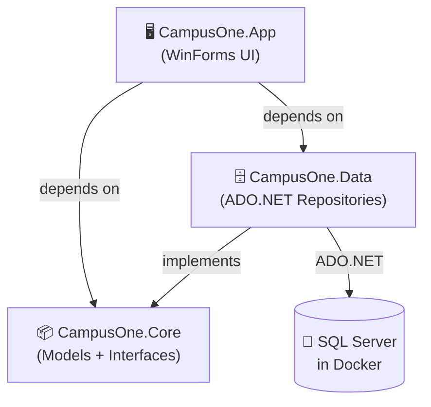
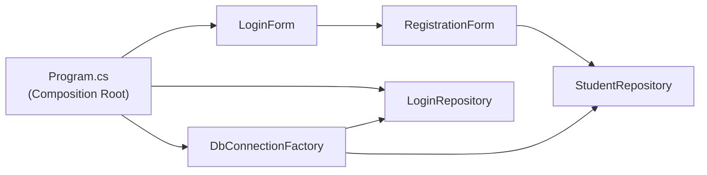
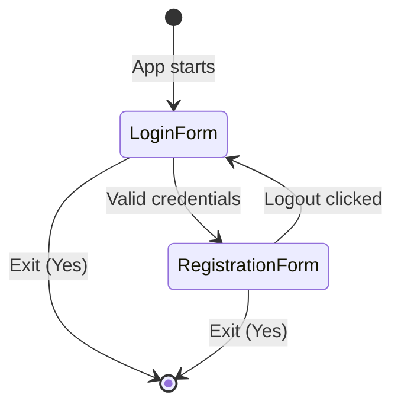

# Campus One Digital Academy – Architecture Guide

> [!NOTE]
> This is a **Windows Forms (WinForms) desktop application** built in C# on .NET 10, using a layered architecture. The database runs in Docker (SQL Server 2022).

---

## Solution Structure

```
padji/
├── CampusOne.sln                   ← Solution file
│
├── src/
│   ├── CampusOne.Core/             ← Domain models & interfaces (no dependencies)
│   │   ├── Models/
│   │   │   ├── Student.cs
│   │   │   └── LoginUser.cs
│   │   └── Interfaces/
│   │       ├── IStudentRepository.cs
│   │       └── ILoginRepository.cs
│   │
│   ├── CampusOne.Data/             ← Data access (ADO.NET + SQL Server)
│   │   ├── DbConnectionFactory.cs
│   │   └── Repositories/
│   │       ├── StudentRepository.cs
│   │       └── LoginRepository.cs
│   │
│   └── CampusOne.App/              ← WinForms UI (references Core & Data)
│       ├── Program.cs              ← Entry point + manual DI wiring
│       ├── AppConfig.cs            ← Connection string config
│       └── Forms/
│           ├── LoginForm.cs
│           └── RegistrationForm.cs
│
├── docker/
│   └── docker-compose.yml          ← SQL Server 2022 container
│
└── scripts/
    ├── init.sql                    ← Creates Student DB + tables
    └── db-start.sh                 ← One-command DB startup
```

---

## Layer Diagram



> [!IMPORTANT]
> The **Core** layer has **zero external dependencies**. This means you can swap the Data layer (e.g., use PostgreSQL or an ORM) without touching the UI or domain models.

---

## Dependency Flow (Dependency Inversion Principle)



Dependencies are constructed once in `Program.cs` (Composition Root pattern). No IoC container is used — the project is small enough that manual wiring is cleaner and easier to understand.

---

## Form Navigation Flow



---

## Database Layer

| Component | Technology |
|---|---|
| Database server | SQL Server 2022 (Docker) |
| Connection | `Microsoft.Data.SqlClient` |
| Query style | Raw parameterised SQL (no ORM) |
| Pattern | Repository Pattern |
| Factory | `DbConnectionFactory` creates connections |

### Why no ORM?
Keeping raw ADO.NET makes the code:
- **Easier to read** – you see exactly what SQL runs
- **No magic** – no hidden N+1 queries or lazy loading surprises
- **Lighter** – no EF Core or Dapper dependency to explain

---

## Design Patterns Used

| Pattern | Where | Why |
|---|---|---|
| **Repository** | `IStudentRepository`, `StudentRepository` | Separates data access from UI logic |
| **Factory** | `DbConnectionFactory` | Single place to manage connection creation |
| **Composition Root** | `Program.cs` | All dependencies wired in one place |
| **Dependency Inversion** | Interfaces in Core, implementations in Data | UI depends on abstractions, not concrete classes |
| **Event / Observer** | `LogoutRequested` event on `RegistrationForm` | Decoupled form-to-form communication |

---

## Docker Configuration

```yaml
# docker/docker-compose.yml
services:
  sqlserver:
    image: mcr.microsoft.com/mssql/server:2022-latest
    ports:  ["1433:1433"]
    volumes:
      - sqlserver_data:/var/opt/mssql      # persistent data
      - ./scripts/init.sql:/docker-entrypoint-initdb.d/init.sql
```

**Connection String (AppConfig.cs):**
```
Server=localhost,1433;Database=Student;User Id=sa;Password=CampusOne@2024;TrustServerCertificate=True;
```

---

## Quick Start

```bash
# 1. Start SQL Server
bash scripts/db-start.sh

# 2. Build & run (Windows only for WinForms)
dotnet run --project src/CampusOne.App
```
