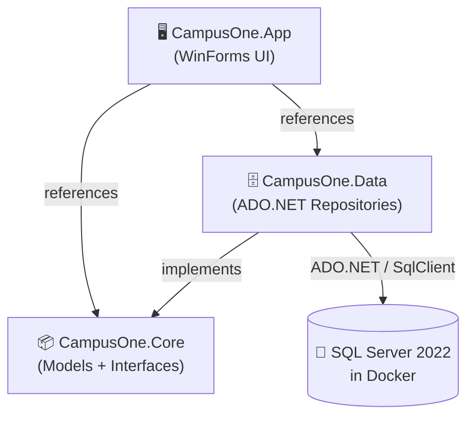
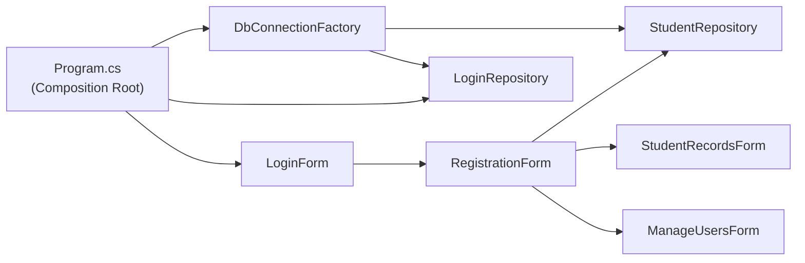
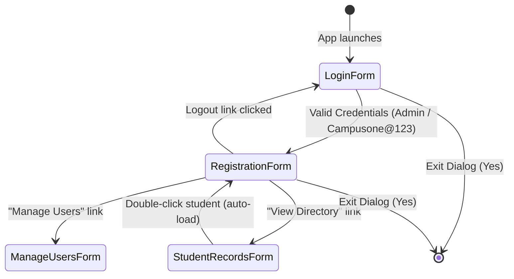

# Campus One Digital Academy – Architecture Guide

> [!NOTE]
> This is a **Windows Forms (WinForms) desktop application** built in C# on .NET 10, using a layered architecture. The database runs in Docker (SQL Server 2022).

---

## Solution Structure

```
padji/
├── CampusOne.slnx                  ← Modern .NET Solution file
│
├── src/
│   ├── CampusOne.Core/             ← Domain models & interfaces (no dependencies)
│   │   ├── Models/
│   │   │   ├── Student.cs          ← 12 domain properties matching DB
│   │   │   └── LoginUser.cs        ← User accounts model
│   │   └── Interfaces/
│   │       ├── IStudentRepository.cs ← CRUD operations contract
│   │       └── ILoginRepository.cs   ← Auth and user management contract
│   │
│   ├── CampusOne.Data/             ← Data access (ADO.NET + SQL Server)
│   │   ├── DbConnectionFactory.cs  ← Central connection creation factory
│   │   └── Repositories/
│   │       ├── StudentRepository.cs← Full student CRUD implementation
│   │       └── LoginRepository.cs  ← Auth + multi-user management
│   │
│   └── CampusOne.App/              ← WinForms UI (references Core & Data)
│       ├── Program.cs              ← Entry point + Composition Root
│       ├── AppConfig.cs            ← Connection string config
│       └── Forms/
│           ├── LoginForm.cs        ← Form 1: Admin login (Figure 1)
│           ├── RegistrationForm.cs ← Form 2: Student registration (Figure 2)
│           ├── StudentRecordsForm.cs← Form 3: Records directory, search & CSV export (Extra Marks)
│           └── ManageUsersForm.cs  ← Form 4: Multi-user admin management (Extra Marks)
│
├── docker/
│   └── docker-compose.yml          ← SQL Server 2022 container with health check
│
├── scripts/
│   ├── init.sql                    ← Creates Student DB + Logins + Registration tables
│   ├── db-start.sh                 ← Linux/macOS startup script
│   ├── db-start.ps1                ← Windows PowerShell startup script
│   └── db-start.bat                ← Windows CMD startup script
│
└── docs/
    ├── ARCHITECTURE.md             ← Architecture specifications
    ├── DATABASE_SCHEMA.md          ← Database ERD & schema
    ├── DESIGN_PATTERNS.md          ← Design pattern breakdown
    ├── DEVELOPER_GUIDE.md          ← Developer handbook
    └── AGENT_HANDOVER.md           ← Complete AI agent state transfer
```

---

## Layer Diagram



> [!IMPORTANT]
> The **Core** layer has **zero external dependencies**. This means you can swap the Data layer (e.g., use PostgreSQL or an ORM) without touching the UI or domain models.

---

## Dependency Flow (Dependency Inversion Principle)



Dependencies are constructed once in `Program.cs` (Composition Root pattern). No heavy IoC container is needed — clean manual dependency injection keeps the codebase fast and readable.

---

## Form Navigation Flow



---

## Database Layer

| Component | Technology |
|---|---|
| Database server | SQL Server 2022 (Docker, port 1433) |
| Connection | `Microsoft.Data.SqlClient` |
| Query style | Raw parameterized SQL (safe against SQL Injection) |
| Pattern | Repository Pattern |
| Factory | `DbConnectionFactory` creates connections |

---

## Design Patterns Used

| Pattern | Where | Why |
|---|---|---|
| **Repository** | `IStudentRepository`, `StudentRepository`, `ILoginRepository`, `LoginRepository` | Decouples SQL database queries from form UI controls |
| **Factory** | `DbConnectionFactory` | Single location to manage connection strings and open connections |
| **Composition Root** | `Program.cs` | All dependencies instantiated and wired in one clean place |
| **Dependency Inversion** | Interfaces in `CampusOne.Core`, implementations in `CampusOne.Data` | Forms rely on interfaces, making testing and swapping implementations easy |
| **Observer / Event** | `RegistrationForm.LogoutRequested`, `StudentRecordsForm.StudentSelected` | Decoupled cross-form communication without circular references |

---

## Quick Start

```bash
# 1. Start SQL Server via Docker
bash scripts/db-start.sh          # Linux/macOS
# OR
.\scripts\db-start.ps1           # Windows PowerShell

# 2. Build & run (Windows)
dotnet run --project src/CampusOne.App
```
