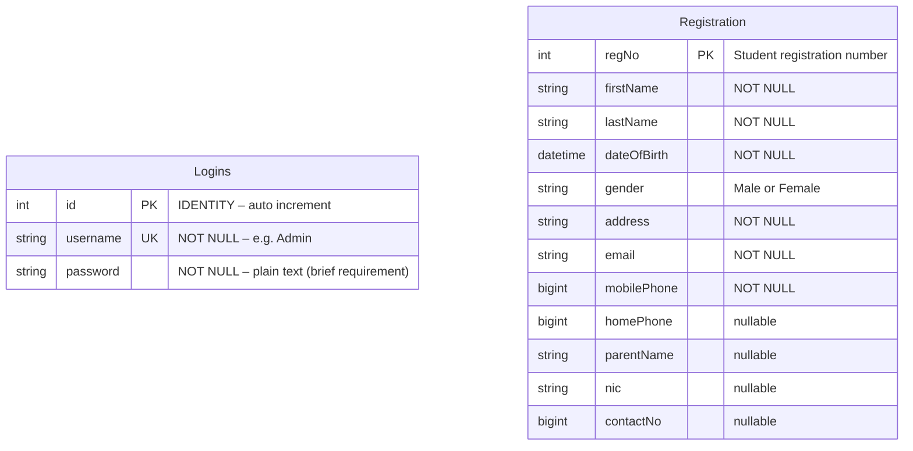

# Campus One Digital Academy – Database Schema

---

## Overview

| Property | Value |
|---|---|
| Database name | `Student` |
| Server | SQL Server 2022 (Docker, port 1433) |
| Runtime driver | `Microsoft.Data.SqlClient` v5.x |
| Script location | [`scripts/init.sql`](file:///home/dimathrj/Documents/dev_projects/padji/scripts/init.sql) |

---

## Entity-Relationship Diagram



---

## Table: `Logins`

Stores application users. Default admin is seeded by `init.sql`.

| Column | Type | Constraint | Notes |
|---|---|---|---|
| `id` | `INT IDENTITY(1,1)` | `PRIMARY KEY` | Auto-increment |
| `username` | `VARCHAR(50)` | `NOT NULL UNIQUE` | Case-sensitive login |
| `password` | `VARCHAR(100)` | `NOT NULL` | Plain text per brief requirements |

**Default row:**

```sql
INSERT INTO Logins (username, password) VALUES ('Admin', 'Campusone@123');
```

---

## Table: `Registration`

The primary data table. Stores one row per registered student.

| Column | Type | Constraint | Notes |
|---|---|---|---|
| `regNo` | `INT` | `PRIMARY KEY` | Manually entered by admin |
| `firstName` | `VARCHAR(50)` | `NOT NULL` | |
| `lastName` | `VARCHAR(50)` | `NOT NULL` | |
| `dateOfBirth` | `DATETIME` | `NOT NULL` | Selected via DateTimePicker |
| `gender` | `VARCHAR(50)` | `NOT NULL` | `'Male'` or `'Female'` |
| `address` | `VARCHAR(50)` | `NOT NULL` | |
| `email` | `VARCHAR(50)` | `NOT NULL` | |
| `mobilePhone` | `BIGINT` | `NOT NULL` | Integer type per brief |
| `homePhone` | `BIGINT` | nullable | Integer type per brief |
| `parentName` | `VARCHAR(50)` | nullable | |
| `nic` | `VARCHAR(50)` | nullable | National ID number |
| `contactNo` | `BIGINT` | nullable | Parent/guardian contact |

---

## Full SQL Script

```sql
-- Create database
IF NOT EXISTS (SELECT name FROM sys.databases WHERE name = 'Student')
    CREATE DATABASE Student;
GO

USE Student;
GO

-- Logins table
IF NOT EXISTS (SELECT * FROM sysobjects WHERE name='Logins' AND xtype='U')
BEGIN
    CREATE TABLE Logins (
        id        INT          IDENTITY(1,1) PRIMARY KEY,
        username  VARCHAR(50)  NOT NULL UNIQUE,
        password  VARCHAR(100) NOT NULL
    );
    INSERT INTO Logins (username, password) VALUES ('Admin', 'Campusone@123');
END
GO

-- Registration table
IF NOT EXISTS (SELECT * FROM sysobjects WHERE name='Registration' AND xtype='U')
BEGIN
    CREATE TABLE Registration (
        regNo       INT          PRIMARY KEY,
        firstName   VARCHAR(50)  NOT NULL,
        lastName    VARCHAR(50)  NOT NULL,
        dateOfBirth DATETIME     NOT NULL,
        gender      VARCHAR(50)  NOT NULL,
        address     VARCHAR(50)  NOT NULL,
        email       VARCHAR(50)  NOT NULL,
        mobilePhone BIGINT       NOT NULL,
        homePhone   BIGINT,
        parentName  VARCHAR(50),
        nic         VARCHAR(50),
        contactNo   BIGINT
    );
END
GO
```

---

## Sample CRUD Queries

```sql
-- SELECT all students
SELECT * FROM Registration ORDER BY regNo;

-- SELECT by Reg No
SELECT * FROM Registration WHERE regNo = 1001;

-- INSERT new student
INSERT INTO Registration
    (regNo, firstName, lastName, dateOfBirth, gender, address, email, mobilePhone)
VALUES
    (1001, 'Kamal', 'Perera', '2005-03-15', 'Male', 'Colombo 3', 'kamal@mail.com', 771234567);

-- UPDATE
UPDATE Registration SET firstName = 'Kamal Revised' WHERE regNo = 1001;

-- DELETE
DELETE FROM Registration WHERE regNo = 1001;
```

---

## Docker Connection Details

| Setting | Value |
|---|---|
| Host | `localhost` |
| Port | `1433` |
| Database | `Student` |
| User | `sa` |
| Password | `CampusOne@2024` |
| TrustServerCertificate | `True` |

> [!WARNING]
> The SA password above is for **local development only**. Never expose port 1433 to the internet or use these credentials in production.
