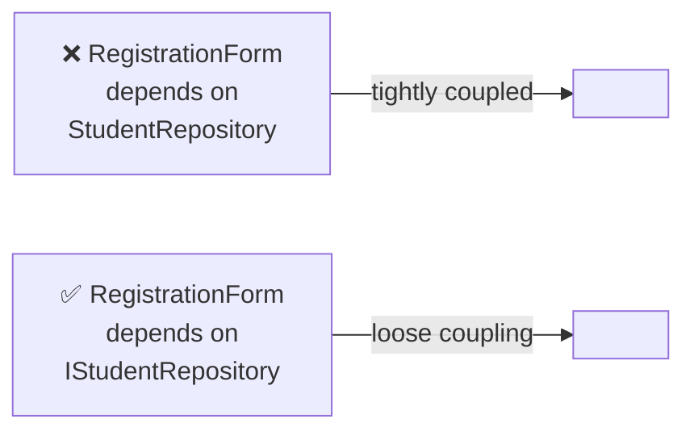
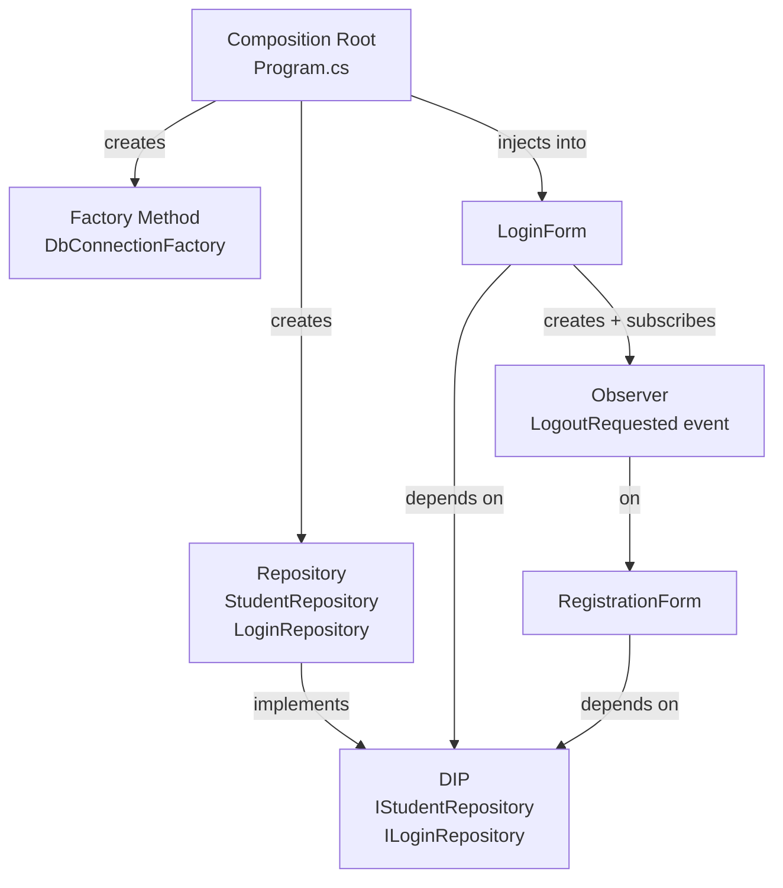

# Campus One Digital Academy – Design Patterns Reference

> [!NOTE]
> This document explains every design pattern used in this project, **why** it was chosen, and where to find it in the codebase.

---

## Patterns At a Glance

| # | Pattern | Category | File(s) |
|---|---|---|---|
| 1 | Repository | Structural | `IStudentRepository`, `StudentRepository` |
| 2 | Factory Method | Creational | `DbConnectionFactory` |
| 3 | Composition Root | Architectural | `Program.cs` |
| 4 | Dependency Inversion (DIP) | SOLID | All interfaces in `Core` |
| 5 | Observer / Event | Behavioural | `RegistrationForm.LogoutRequested` |

---

## 1. Repository Pattern

### What it is
Wraps all database access inside a class that looks like an in-memory collection. The caller doesn't know (or care) whether data comes from SQL Server, an API, or a file.

### Why we used it
The WinForms forms should **not** contain SQL strings. If a table column is renamed, we change one repository file — not every button click handler.

### Where it is

```
Core/Interfaces/IStudentRepository.cs   ← contract
Data/Repositories/StudentRepository.cs ← SQL implementation
```

### Code sketch

```csharp
// Core/Interfaces/IStudentRepository.cs
public interface IStudentRepository
{
    IEnumerable<Student> GetAll();
    Student? GetByRegNo(int regNo);
    void Add(Student student);
    void Update(Student student);
    void Delete(int regNo);
    IEnumerable<int> GetAllRegNos();
}

// Data/Repositories/StudentRepository.cs
public class StudentRepository : IStudentRepository
{
    public Student? GetByRegNo(int regNo)
    {
        using var conn = _factory.Create();
        using var cmd  = new SqlCommand("SELECT * FROM Registration WHERE regNo = @regNo", conn);
        cmd.Parameters.AddWithValue("@regNo", regNo);
        using var reader = cmd.ExecuteReader();
        return reader.Read() ? MapRow(reader) : null;
    }
    // ... other methods
}
```

---

## 2. Factory Method Pattern

### What it is
A dedicated class whose only job is to **create** objects — in this case, open SQL connections.

### Why we used it
Without a factory:
- Every repository would repeat the same connection string
- Changing the string means editing 5 different files

With `DbConnectionFactory`, the string lives in exactly one place.

### Where it is

```
Data/DbConnectionFactory.cs
```

### Code sketch

```csharp
public class DbConnectionFactory
{
    private readonly string _connectionString;

    public DbConnectionFactory(string connectionString) =>
        _connectionString = connectionString;

    // Call this to get a ready-to-use, open connection
    public SqlConnection Create()
    {
        var conn = new SqlConnection(_connectionString);
        conn.Open();
        return conn;
    }
}
```

Every repository calls `_factory.Create()` and disposes the connection with `using`.

---

## 3. Composition Root

### What it is
A single location in the application where **all dependencies are created and wired together**. This is always the entry point (`Program.cs`).

### Why we used it
Avoids "new everywhere" — no form creates its own repository. This makes testing easier because you can substitute a fake repository from outside.

### Where it is

```
App/Program.cs
```

### Code sketch

```csharp
[STAThread]
static void Main()
{
    ApplicationConfiguration.Initialize();

    // All dependencies created in one place
    var factory   = new DbConnectionFactory(AppConfig.ConnectionString);
    var loginRepo = new LoginRepository(factory);

    // Hand dependencies into the form — not constructed inside the form
    Application.Run(new LoginForm(loginRepo));
}
```

---

## 4. Dependency Inversion Principle (DIP)

### What it is
> *"High-level modules should not depend on low-level modules. Both should depend on abstractions."*

In practice: forms depend on **interfaces** (from Core), not on **concrete classes** (from Data).

### Why we used it



If we later switch from SQL Server to PostgreSQL, we write a new `PostgresStudentRepository : IStudentRepository` and change **one line in Program.cs** — nothing in the form.

### Where it is

```
Core/Interfaces/   ← all interfaces (abstractions)
Data/Repositories/ ← concrete classes that implement them
App/Forms/         ← constructors accept interfaces
```

### Code sketch

```csharp
// Form constructor accepts the INTERFACE, not the class
public class RegistrationForm : Form
{
    private readonly IStudentRepository _studentRepo;

    public RegistrationForm(IStudentRepository studentRepo)
    {
        _studentRepo = studentRepo;
    }
}
```

---

## 5. Observer Pattern (C# Events)

### What it is
Allows one object to notify other objects when something happens, **without** the notifier knowing who is listening.

### Why we used it
`RegistrationForm` needs to tell `LoginForm` "the user logged out" — but it shouldn't hold a reference to `LoginForm`. Using an event keeps the two forms decoupled.

### Where it is

```
App/Forms/RegistrationForm.cs   → declares the event
App/Forms/LoginForm.cs          → subscribes to the event
```

### Code sketch

```csharp
// RegistrationForm — publishes
public class RegistrationForm : Form
{
    public event Action? LogoutRequested;

    // called when user clicks Logout link
    llLogout.LinkClicked += (_, _) => LogoutRequested?.Invoke();
}

// LoginForm — subscribes
var regForm = new RegistrationForm(studRepo);
regForm.LogoutRequested += () =>
{
    regForm.Hide();
    Show();           // show login form again
    txtUsername.Clear();
    txtPassword.Clear();
    txtUsername.Focus();
};
```

---

## Pattern Interaction Diagram


